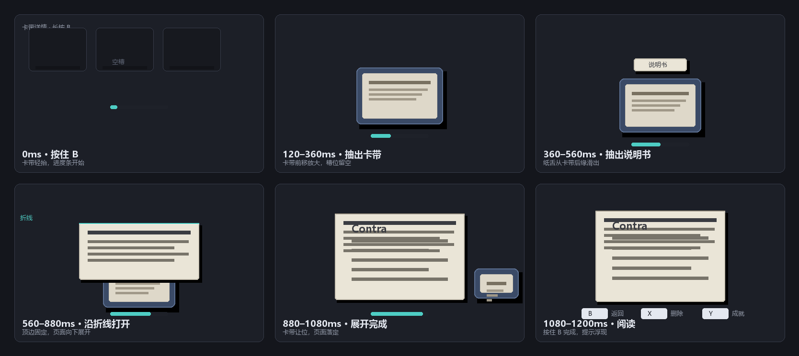

# 卡带详情 · 长按 B 过渡设计稿（v1）

> 目标：把现在"卡带翻转 → 纸片放大"的两段式动画，改成一次连贯的"抽出卡带 → 抽出说明书 → 翻开说明书"。
> 总时长保持 1200ms，交互（按住预览、提前松手回退）不变。

---

## 1. 现在为什么显得割裂

当前时间轴（`INTRO_OPEN_MS = 1200ms`）：

| 阶段 | 时长 | 画面 |
|---|---|---|
| 按住确认 | 120ms | 卡带静止，进度条开始 |
| 卡带翻转 | 600ms | 绕竖轴翻转，正面 → 背面 |
| 停顿 | 60ms | 停在背面标签 |
| 抽纸舌 | 200ms | 一条窄纸从卡带背后滑出 |
| 停顿 | 60ms | 纸舌停住 |
| 放大 | 160ms | 纸舌从中心放大成整张详情卡，内容淡入 |

问题出在三个"不连续"：

1. **主角换了两次**：先盯着卡带翻转，再盯着一条纸舌，最后盯着放大后的页面；观众要重新定位视线。
2. **"放大"不是"打开"**：最后 160ms 是把整张卡片从中心均匀放大 + 透明度淡入，没有折线、没有铰链、没有遮挡关系，看起来像 UI 缩放，而不是纸被翻开。
3. **空间关系断了**：卡带翻转后停在原地，纸舌从它背后出现，页面最后又盖满全屏；卡带、纸、页面三者的前后/遮挡关系没有交代清楚。

一句话：**"翻转"和"放大"是两个动作，中间没有一个把二者连起来的物理动作。**

---

## 2. 推荐方案：抽卡带 → 抽说明书 → 沿折线翻开

### 2.1 动作链

1. 按住 B：卡带轻微抬起，进度条开始（保留现有反馈）；
2. **抽出卡带**：卡带朝屏幕前上方移动并轻微放大，槽位留空——明确"我把它拿出来了"；
3. **抽出说明书**：一条对折的纸舌从卡带后缘滑出，纸舌上能看到"说明书"的折边；
4. **翻开**：纸舌的**顶边作为折线固定不动**，下半页沿折线向下展开；内容在展开超过一半后才淡入；
5. **落定**：说明书展开到详情卡大小，卡带向右下滑出/淡出，完成"把卡带放下、开始读说明书"的因果；
6. **阅读**：底部提示浮现（B 返回、X 删除、Y 成就），按住 B 满 1200ms 后进入可操作状态。

关键点：**从头到尾只有"卡带"和"同一张纸"两个物体**；纸不是凭空出现，而是从卡带里抽出来的；页面不是被放大，而是被翻开。

### 2.2 分镜

| 帧 | 时间 | 画面 | 动作要点 |
|---|---|---|---|
| 1 | 0ms | 卡带在槽内，按住 B | 卡带轻抬 4px，进度条 0→10% |
| 2 | 120–360ms | 卡带前移、放大，槽位空 | 卡带 1.0→1.16 倍，-2° 微倾，阴影加深；其它卡带变暗 |
| 3 | 360–560ms | 纸舌从卡带后缘滑出 | 纸舌宽约卡带 60%，高约 28px；卡带向后退 6px，让出纸的位置 |
| 4 | 560–880ms | 纸舌沿顶边折线向下展开 | 顶边固定；页面高度 28px→420px，宽度 60%→100%；折线阴影 + 纸面高光 |
| 5 | 880–1080ms | 页面展开完成，卡带让位 | 卡带向右下移 24px 并淡到 0.35，再淡出；页面轻微回弹（1.5%）后落定 |
| 6 | 1080–1200ms | 阅读态 | 内容、统计、成就进度、按键提示完全可见；1200ms 时进度条消失、armed |

### 2.3 时间与曲线

| 阶段 | 时间 | 曲线 |
|---|---|---|
| 按住确认 | 0–120ms | ease-out |
| 抽出卡带 | 120–360ms | cubic ease-out（先快后慢） |
| 抽出说明书 | 360–560ms | ease-out-back（1.02 轻微过冲） |
| 翻开 | 560–880ms | ease-in-out（折线先慢、中段快、末端收） |
| 落定 | 880–1080ms | spring ease-out（1.5% 回弹） |
| 阅读/armed | 1080–1200ms | 静止 |

- 进度条覆盖完整 1200ms，与页面落定同步；
- 提前松手：从当前进度反向播放 `INTRO_CANCEL_MS = 260ms`，不跳回起点；
- 关闭：从当前进度反向 `INTRO_CLOSE_MS = 420ms`。

### 2.4 视觉规格

| 元素 | 规格 |
|---|---|
| 纸面 | 沿用 `INTRO_PAPER` `#EAE5D7`，边框 `INTRO_PAPER_BORDER` `#C9C3B4` |
| 折线 | 2px 深色线 + 下方 1px 高光；折线处加 12px 渐变阴影，制造纸张厚度 |
| 页面 | 最终 640×420，圆角 4px，投影 24px；与现在详情卡一致 |
| 卡带 | 保持**正面**，不翻到背面；轻微 -2°~-3° 倾斜，阴影随高度增加 |
| 背景 | 全屏压暗到 0.72，其它卡带降到 0.55 亮度 |
| 内容 | 展开进度 >55% 后才开始淡入；文字不随页面缩放（见实现说明） |
| 提示 | 底部 B 返回 / X 删除 / Y 成就；900ms 后一起淡入 |
| 音效（可选） | 抽纸"沙"一声、翻页"嗒"一声；没有音效也不影响理解 |

### 2.5 交互规则

- 按住 B 期间：只响应 B 松开（回退）；其它按键忽略；
- 松手回退：从当前画面反向播放，不突然消失；
- 1200ms 后：`armed`，进度条消失；B 关闭、X 删除确认、Y 打开成就页（沿用当前 X/Y 交换后的映射）；
- 若没有简介/封面：说明书照常打开，内容区显示占位文案；
- 若该游戏没有成就定义：底部不显示 Y 成就提示，或显示为灰色不可用（二选一，见待确认项）。

---

## 3. 2D 渲染的实现建议

现有渲染器只有 `Draw::Rect / Tex / Turned`，没有真正的 3D 变换和裁剪。建议：

1. **不再翻卡带**：删除 `draw_intro_flip` 的背面阶段，保留正面；新增 `draw_intro_pull` 只做平移 + 缩放 + 倾斜 + 阴影。
2. **折线固定顶边**：把 `unfold_intro_draws` 改为：
   - 顶边 `y` 固定为纸舌顶边；
   - 宽度从纸舌宽 → 640，围绕水平中心展开；
   - 高度从 28 → 420，只向下增长；
   - 不再对整张页面做中心缩放。
3. **避免文字拉伸**：页面按最终尺寸排版，展开时用 **10–16 条水平切片**逐条绘制，只画折线以下已经展开的切片；这样文字保持原比例，不会被压扁。
4. **折线阴影**：在折线下方绘制 12px 高的线性渐变矩形（`Draw::Rect` 叠加），外加一条 1px 高光。
5. **卡带让位**：展开阶段卡带 `x += 24 * k`、`y += 24 * k`、透明度 `1 - 0.65k`，最后 200ms 淡出。
6. **贴纸/封面**：沿用现有 `push_intro_card` 的排版，只改外层变换；封面、视频、统计、成就行都不动。

---

## 4. 备选方案

| 方案 | 描述 | 优点 | 缺点 |
|---|---|---|---|
| **A（推荐）抽卡带 → 抽说明书 → 翻开** | 本文方案 | 物理因果完整；保留"纸"的质感；改动集中在 intro 动画 | 需要切片遮罩和折线绘制 |
| B 翻到卡带背面 | 抽出卡带后直接翻到背面，背面标签就是详情页 | 最简单；不需要纸和折线 | 背面要塞下大量文字；"翻面"仍有一点跳 |
| C 打开卡带盒 | 卡带壳像盒子一样打开，详情在盒内 | 最符合"打开" | 2D 下需要近似 3D，成本高 |
| D 插入读卡器 | 卡带插进读卡器，屏幕扩展成详情 | 有仪式感 | 引入新物体，偏离"抽纸"直觉 |

**建议选 A**：它最接近你说的"抽纸然后打开"，且不需要真正的 3D。

---

## 5. 验收标准

- [ ] 从按住 B 到页面可阅读，**没有物体跳变/主角切换**；
- [ ] 纸从卡带后缘连续滑出，卡带和纸的遮挡关系正确；
- [ ] 页面沿**顶边折线**展开，不是从中心放大；
- [ ] 展开过程中文字不被压扁，内容在 >55% 后淡入；
- [ ] 提前松手能从任意进度平滑回退（260ms）；
- [ ] 关闭动画（420ms）反向播放，不闪回开场；
- [ ] 底部提示顺序为 B 返回、X 删除、Y 成就；
- [ ] 720×480 下页面 640×420，文字不溢出；
- [ ] 60fps 下无明显掉帧（切片数量控制在 16 以内）。

## 6. 待确认

1. 卡带在页面展开后是**滑出画面**还是**留在右下角当锚点**？我倾向滑出并淡出，避免遮挡页面。
2. 抽出的说明书是**从卡带上方**还是**从下方**出来？分镜按"从后缘向上"画，若觉得像抽纸巾，可改成从下方抽出再翻。
3. 是否要加音效（抽纸/翻页）？没有也不影响。
4. 没有成就定义时，Y 提示是**隐藏**还是**灰色不可用**？
